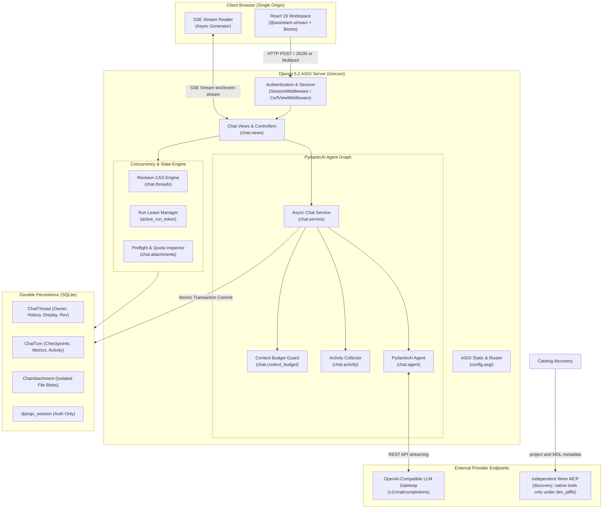

# AYCE Analytics V2

<p align="center">
  
  
  
  
  
  
  
  
  
</p>

A high-performance, single-origin, multi-user chat workspace built for enterprise data analytics. Backed by **Django 5.2 (ASGI)** and **PydanticAI**, AYCE Analytics V2 streams real-time conversational responses from any OpenAI-compatible model gateway, provides zip-bomb-proof file attachment extraction, and guarantees robust multi-tab concurrency using atomic Compare-and-Swap (CAS) revisions and checkpoint-safe rollbacks. This release adds audited Superadmin/Lead/Staff administration, department-scoped chat context, and an explicitly assigned dataset catalog. AYCE owns identity, grants, orchestration and history. An independent Wren service supplies catalog metadata. Synthetic full-project queries run only when `AYCE_ANALYTICS_MODE=dev_jaffle` passes its gates. The shipped default is `off`. There is no Governed MCP Gateway, and production partial-dataset execution stays disabled.

---

## Table of Contents

- [Key Features](#key-features)
- [Architecture Overview](#architecture-overview)
- [Tech Stack](#tech-stack)
- [Prerequisites](#prerequisites)
- [Quick Start](#quick-start)
- [Environment Configuration](#environment-configuration)
- [Synthetic DEV proof](#synthetic-dev-proof)
- [Account Provisioning](#account-provisioning)
- [Development Recipes](#development-recipes)
- [Testing & Quality Assurance](#testing--quality-assurance)
- [API & Streaming Protocol](#api--streaming-protocol)
- [Project Structure](#project-structure)
- [Documentation Index](#documentation-index)
- [AI Agent Handbook](#ai-agent-handbook)
- [License & Attributions](#license--attributions)

---

## Key Features

- **Multi-Tenant User Isolation**: Strict ownership scoping; users only ever access their own conversations, attachments, and turn checkpoints.
- **PydanticAI Agent Graph**: Async streaming agent powered by `pydantic-ai-slim`, featuring dynamic system instruction policies, token delta debouncing, and model request hooks.
- **Synthetic DEV analytics (default off)**: `AYCE_ANALYTICS_MODE=off` attaches no analytics tools. `dev_jaffle` may attach reviewed native Wren tools only after Django admits both `customers` and `orders` for that department. A partial grant stays ordinary chat. Catalog hashes identify the admitted snapshot; they are not physical isolation. A turn that carries dataset provenance cannot be regenerated. See [Operations](docs/operations-and-security.md).
- **Server-Sent Events (SSE) Streaming**: Real-time token streaming (`delta`), atomic activity timeline updates (`activity`), commit confirmations (`done`), and sanitized error payloads (`error`).
- **Atomic Compare-and-Swap (CAS) Concurrency**: Monotonic thread revisions guard every mutation. Multiple browser tabs never overwrite each other; conflicting writes fail gracefully with `409 thread_conflict`.
- **Database Run Lease**: Generative LLM runs are serialized via short database leases (`active_run_token`), preventing race conditions without table-level database locks.
- **Checkpoint-Safe Regeneration & Turn Deletion**: Each completed turn stores an exact canonical history checkpoint (`pre_history_json`). Easily regenerate the latest response or cleanly roll back previous exchanges.
- **Safe Multi-Modal Attachments**: Ingests TXT, MD, CSV, JSON, PDF, PNG, JPG, GIF, WEBP, DOCX, and XLSX files. Office files are decompressed in-memory with strict zip-bomb, XXE, and macro guards, then converted to clean TSV.
- **Conservative Token & Context Budgeting**: Application-owned context windows (`LLM_CONTEXT_WINDOW`) and output limits (`LLM_MAX_OUTPUT_TOKENS`) guarded by conservative byte-based preflight estimations and provider usage feedback.
- **Responsive Accessible Frontend**: Crafted with React 19, `@assistant-ui/react`, and Plus Jakarta Sans. Features an expandable **Thoughts** disclosure panel, message provenance metrics, and responsive desktop/tablet/mobile layouts.

---

## Architecture Overview



---

## Tech Stack

| Tier | Technologies |
| --- | --- |
| **Backend & ASGI** | Python 3.12, Django 5.2, Uvicorn 0.54, asgiref |
| **Agent & Tools** | PydanticAI 2.66 (`pydantic-ai-slim`), independent Wren MCP (`fastmcp-slim` client; metadata discovery, optional synthetic DEV tools), defusedxml, python-docx, openpyxl |
| **Persistence** | SQLite 3 (Hot backup support, JSON serialization, transaction rollback) |
| **Frontend UI** | React 19.3, React DOM 19.3, `@assistant-ui/react`, react-markdown, remark-gfm |
| **Build & Tooling** | Vite 8.3, TypeScript 5.9, Biome 2.6, Vitest 5.1, uv, just, Ruff |
| **Typography** | Plus Jakarta Sans (`@fontsource/plus-jakarta-sans`, SIL OFL 1.1) |

---

## Prerequisites

- **Python**: Version `3.12`
- **Package Manager**: [uv](https://docs.astral.sh/uv/) (>= 0.5.0)
- **Node.js**: `20.19+` or `22.12+` (Required by Vite 8)
- **Task Runner** *(Optional)*: [just](https://github.com/casey/just)

---

## Quick Start

### 1. Clone & Setup Dependencies
Using `just`:
```bash
just setup      # Runs uv sync --locked, npm ci, and python manage.py migrate
cp .env.example .env
```

Or using standard tool commands:
```bash
uv sync --locked
npm ci
uv run --locked python manage.py migrate
cp .env.example .env
```

### 2. Configure Environment
Edit `.env` with your LLM provider credentials and secret keys (see [Environment Configuration](#environment-configuration)).

### 3. Provision an Admin Account
```bash
uv run --locked python manage.py createsuperuser
```

### 4. Run the Development Server
```bash
just dev
# Or without just:
# npm run build && uv run --locked python scripts/serve.py
```
Open [http://127.0.0.1:8000](http://127.0.0.1:8000) in your browser and sign in.

---

## Environment Configuration

Configure `.env` in the project root:

| Key | Required | Default | Description |
| --- | --- | --- | --- |
| `DJANGO_SECRET_KEY` | **Yes** | — | Unique Django secret cryptographic key |
| `DJANGO_DEBUG` | No | `false` | Enable debug mode (`true` or `false`). In debug mode, ASGI serves static assets directly. |
| `DJANGO_ALLOWED_HOSTS` | No | `127.0.0.1,localhost` | Comma-separated list of permitted host headers |
| `DJANGO_HOST` | No | `127.0.0.1` | Network bind address for `just dev` / `scripts/serve.py` |
| `DJANGO_PORT` | No | `8000` | Network bind port (1 - 65535) |
| `LLM_BASE_URL` | For Chat | — | OpenAI-compatible endpoint base URL (e.g. `https://api.openai.com/v1`) |
| `LLM_API_KEY` | For Chat | — | Provider API key |
| `LLM_MODEL` | For Chat | — | Model identifier (e.g. `gpt-4o`, `claude-3-5-sonnet`) |
| `WREN_MCP_URL` | No | `""` | Wren MCP endpoint. Blank disables discovery. With `dev_jaffle` it must equal `AYCE_DEV_WREN_MCP_URL`. Not query authorization by itself. |
| `AYCE_ANALYTICS_MODE` | No | `off` | `off` or `dev_jaffle`. Blank means `off`. Any other value, including `scoped`, fails startup. |
| `AYCE_DEV_WREN_MCP_URL` | For `dev_jaffle` | `""` | Must equal `WREN_MCP_URL`. Absolute loopback HTTP(S): literal `127.0.0.1` or `[::1]`, explicit port, no userinfo, query, or fragment. |
| `AYCE_DEV_WREN_PROJECT` | For `dev_jaffle` | `""` | Must be exactly `jaffle-wren`. |
| `AYCE_DEV_JAFFLE_CONFIRMED` | For `dev_jaffle` | `false` | Must be `true`, and `DJANGO_DEBUG` must be `true`. Operator attestation of the synthetic deployment, not isolation. |
| `LLM_CONTEXT_WINDOW` | No | `32768` | Application input token budget + reserved output tokens |
| `LLM_MAX_OUTPUT_TOKENS` | No | `4096` | Output tokens requested per completion (must be smaller than context window) |
| `CHAT_MAX_FILES_PER_THREAD`| No | `5` | Maximum stored attachments allowed per conversation |
| `CHAT_MAX_FILES_PER_TURN` | No | `5` | Maximum new uploads in a single user turn |
| `CHAT_MAX_FILE_BYTES` | No | `5242880` (5 MB) | Maximum size per uploaded file in bytes |
| `CHAT_MAX_TEXT_BYTES_PER_FILE` | No | `65536` (64 KB) | Prepared UTF-8 plain text cap per document |
| `CHAT_MAX_TEXT_BYTES_PER_THREAD` | No | `262144` (256 KB)| Total prepared plain text cap per conversation |
| `CHAT_SHOW_REASONING_DETAIL` | No | `false` | Ordinary chat only. A tool-enabled run stays generic even for a native superuser. |

---

## Synthetic DEV proof

Keep `AYCE_ANALYTICS_MODE=off` for ordinary installs. Synthetic proof uses a **fresh** worktree `db.sqlite3` created by `migrate`. Do not copy another checkout's database, users, sessions, grants, or chat history. If `db.sqlite3` already exists and is not this worktree's migrated file, use another worktree path instead of deleting it.

Create the operator with `createsuperuser` (`wren-dev-operator` in the proof database). Never print that password. Later accounts, departments, catalog refresh, and grants go through `accounts.services` and `datasets.services` with `actor_id` and the current revision. Do not write permissions, memberships, or grants directly.

`scripts/smoke_wren_chat.py` is operator-only. It never prints passwords, cookies, endpoints, or raw transport errors. Actions are mutually exclusive:

```bash
uv run --locked python scripts/smoke_wren_chat.py --diagnose-only
uv run --locked python scripts/smoke_wren_chat.py --service-only --provision --database "$PWD/db.sqlite3"
uv run --locked python scripts/serve.py --noreload
uv run --locked python scripts/smoke_wren_chat.py --execute --provision --base-url http://127.0.0.1:8001 --database "$PWD/db.sqlite3" --session-file "$TEMP/ayce-wren-smoke-session.json"
```

`--database` must be this worktree's `db.sqlite3` and Django's configured database. `--diagnose-only` checks live identity and inventory, runs the orders count, and prints safe status. `--service-only` calls `stream_answer` and releases the lease without committing the diagnostic turn. `--execute` requires a running ASGI server and proves committed full-project provenance plus a partial-grant run with no native tools. `--session-file` must sit outside the repository; the script also writes `<stem>-partial.json`. Gates, operator assumptions, and the production boundary are in [Operations](docs/operations-and-security.md).


## Account Provisioning

AYCE Analytics V2 has no public registration endpoint. Accounts are managed by operators:

1. **Initial Superuser**: Created via CLI:
   ```bash
   uv run --locked python manage.py createsuperuser
   ```
2. **Staff Administration**: Sign in at `/admin/auth/user/` to provision, edit, reset passwords, or deactivate accounts.
3. **Account Deactivation**: Deactivating an account immediately revokes access without deleting their chats or attachment records.

---

## Development Recipes

All development workflows are automated via `justfile`:

```bash
just --list
```

| Recipe | Description |
| --- | --- |
| `just dev` | Build frontend bundle, then start Uvicorn ASGI server with live reloading |
| `just dev-noreload` | Run server without the autoreloader |
| `just frontend-build` | Compile `frontend/` into `chat/static/chat/dist/` using Vite |
| `just frontend-check` | Run Biome linter and TypeScript compiler check (`tsc --noEmit`) |
| `just frontend-test` | Run frontend API and streaming tests with Vitest |
| `just check` | Run Django system checks |
| `just test` | Run complete backend Django test suite (189 tests) |
| `just lint` | Run Ruff linter on all Python modules |
| `just lint-format` | Check Python code formatting with Ruff |
| `just fmt` | Apply Ruff lint autofixes and format all Python files |
| `just hooks` | Execute all pre-commit hooks against every file |
| `just hooks-install` | Install Git pre-commit hooks |
| `just ci` | Reproduce the complete CI pipeline locally |
| `just info` | Output resolved tool and dependency versions |

---

## Testing & Quality Assurance

The codebase is thoroughly tested across both backend and frontend layers:

```bash
# Backend Django test suite (Runs 189 tests fully offline against FunctionModel stubs)
uv run --locked python manage.py test tests --verbosity 2

# Frontend Vitest test suite (Runs 138 tests across 5 suites in jsdom)
npm test
```

### Backend Test Coverage:
- `tests/test_chat_service.py`: Real PydanticAI streaming agents, delta debouncing, tool call mapping, context budget hook boundaries, and length-cap handling.
- `tests/test_chat_views.py`: Authenticated SSE streaming, commit-before-`done` ordering, ASGI disconnect handling, CAS revision conflicts, regeneration, and run lease serialization.
- `tests/test_chat_threads.py`: Owner-scoped CRUD, CAS guards, checkpoint storage and turn rollback, cascade deletions, and data migrations.
- `tests/test_chat_attachments.py`: Multipart uploads, magic byte signatures, OOXML zip-bomb and XXE rejection, and plain-text conversion.
- `tests/test_chat_accounts.py`: Session cookies, login redirects, CSRF enforcement, and admin access control.

---

## API & Streaming Protocol

Every private page and API response is protected by `Cache-Control: no-store`.

### REST Route Summary
| Method | Route | Description |
| --- | --- | --- |
| `GET` | `/` | Main workspace view (unselected chat) |
| `GET` | `/chat/<uuid:id>/` | Workspace view loaded with specified thread |
| `GET` | `/api/threads/` | List current user's threads (newest first) |
| `POST` | `/api/threads/` | Create an empty thread (`201 Created`) |
| `GET` | `/api/threads/<id>/` | Read thread details, display pairs, and turns |
| `PATCH` | `/api/threads/<id>/` | Rename thread title (requires `revision`) |
| `DELETE` | `/api/threads/<id>/` | Delete thread (requires `revision`) |
| `POST` | `/api/threads/<id>/messages/` | Send message & stream assistant reply (SSE) |
| `POST` | `/api/threads/<id>/turns/<turn>/regenerate/` | Regenerate latest turn response (SSE) |
| `DELETE` | `/api/threads/<id>/turns/<turn>/` | Delete latest turn pair and rollback history |

### SSE Wire Protocol
Streaming endpoints emit structured Server-Sent Events (`text/event-stream`):

1. `: connected\n\n`: Immediate connection handshake.
2. `event: delta`: Assistant text chunk: `{"text": "..."}`.
3. `event: activity`: Step progress in the execution timeline: `{"turn_id": "...", "step": {...}, "truncated": false}`.
4. `event: done`: Emitted **only after** state is durably committed to the database: `{"reply": "...", "thread": {...}, "turn": {...}}`.
5. `event: error`: Emitted on failure: `{"error": {"code": "...", "message": "..."}}`.

For comprehensive details on error envelopes and status codes, see [API & Protocol Documentation](docs/api-and-protocol.md).

---

## Project Structure

```text
ayce-analytics-v2/
├── chat/                                # Django application
│   ├── activity.py                      # Bounded activity collector & timeline sanitization
│   ├── agent.py                         # PydanticAI Agent instantiation & instructions
│   ├── attachments.py                   # File parsing, OOXML safeguards, dehydration/hydration
│   ├── context_budget.py                # Preflight token estimation & PydanticAI budget hooks
│   ├── models.py                        # ChatThread, ChatTurn, ChatTurnDataset, ChatAttachment
│   ├── mcp.py                           # Reviewed native Wren adapter
│   ├── mcp_policy.py                    # Synthetic DEV scope; no network calls
│   ├── service.py                       # Async streaming graph, delta debouncing, event mapping
│   ├── threads.py                       # Owner-scoped queries, CAS mutations, checkpoints, leases
├── config/                              # Django configuration
│   ├── asgi.py                          # ASGI application definition (Uvicorn)
│   ├── settings.py                      # Environment configuration & limit validation
│   └── urls.py                          # Root URL dispatch
├── docs/                                # Technical domain documentation
│   ├── README.md                        # Documentation index & sitemap
│   ├── architecture.md                  # System architecture, topology, lifecycle diagrams
│   ├── agent-and-tools.md               # PydanticAI, synthetic DEV tools, prompt policies, activity collector
│   ├── concurrency-and-storage.md       # CAS revisions, database run leases, turn checkpoints
│   ├── attachments-and-budgeting.md     # Attachment pipeline, OOXML safety, token budgeting
│   ├── api-and-protocol.md              # REST endpoints, SSE wire protocol, error catalog
│   ├── frontend-workspace.md            # React 19 architecture, state, UI components
│   └── operations-and-security.md       # Deployment, Nginx proxy, SQLite backups, threat model
├── frontend/                            # React 19 frontend
│   └── src/
│       ├── api.ts                       # Fetch client & CAS mutation requests
│       ├── stream.ts                    # SSE parser & activity state reducer
│       ├── Chat.tsx                     # Message feed, composer, regeneration preview
│       ├── Sidebar.tsx                  # Thread list, thread management, user menu
│       ├── Workspace.tsx                # Root layout orchestrator & keyboard navigation
│       └── components/chat/             # ThoughtsPanel, MessageMetrics, DeleteTurnDialog
├── scripts/
│   ├── django_check.py                  # Standalone check script
│   ├── serve.py                         # Uvicorn ASGI runner
│   └── smoke_wren_chat.py               # Operator diagnose, service, and HTTP proofs
├── tests/                               # Comprehensive test suite (189 backend + 138 frontend tests)
├── AGENTS.md                            # AI Agent handbook, coding standards, and invariants
├── justfile                             # Task automation recipes
├── package.json                         # Frontend dependencies & scripts
├── pyproject.toml                       # Python dependencies (uv) & Ruff configuration
└── README.md                            # Repository README
```

---

## Documentation Index

Detailed technical documentation is available in the [`docs/`](docs/) directory:

- 🏛️ **[System Architecture & Design](docs/architecture.md)**: Deep dive into the ASGI stack, execution boundaries, and end-to-end request lifecycles.
- 🤖 **[PydanticAI Agent & Tool Integration](docs/agent-and-tools.md)**: Prompt engineering, synthetic DEV tool boundary, error isolation, and activity timeline mechanics.
- 🔒 **[Concurrency, Storage & Checkpoints](docs/concurrency-and-storage.md)**: Compare-and-Swap revision control, run lease management, and turn checkpoint rollbacks.
- 📎 **[Attachments & Token Budgeting](docs/attachments-and-budgeting.md)**: File upload parsing, zip-bomb defense, document TSV conversion, and input token guards.
- 📡 **[API Reference & SSE Protocol](docs/api-and-protocol.md)**: Endpoint catalog, JSON schemas, Server-Sent Events wire format, and error code reference.
- 💻 **[Frontend Architecture & Workspace](docs/frontend-workspace.md)**: React 19 component tree, optimistic UI updates, streaming state, and layout design.
- 🛡️ **[Operations, Deployment & Security](docs/operations-and-security.md)**: Zero-trust threat model, Nginx reverse proxy setup, and online SQLite backup procedures.

---

## AI Agent Handbook

Are you an AI coding agent (Claude, Codex, Antigravity, Cursor, etc.) working on this repository?
Please read **[AGENTS.md](AGENTS.md)** before modifying or refactoring code. It outlines the core architectural invariants, CAS revision rules, lease mechanics, error sanitization guidelines, and Karpathy coding standards.

---

## License & Attributions

- **Codebase**: Licensed under the MIT License.
- **Typography**: [Plus Jakarta Sans](https://github.com/tokotype/PlusJakartaSans) by Tokotype, licensed under the [SIL Open Font License 1.1](https://openfontlicense.org/).
