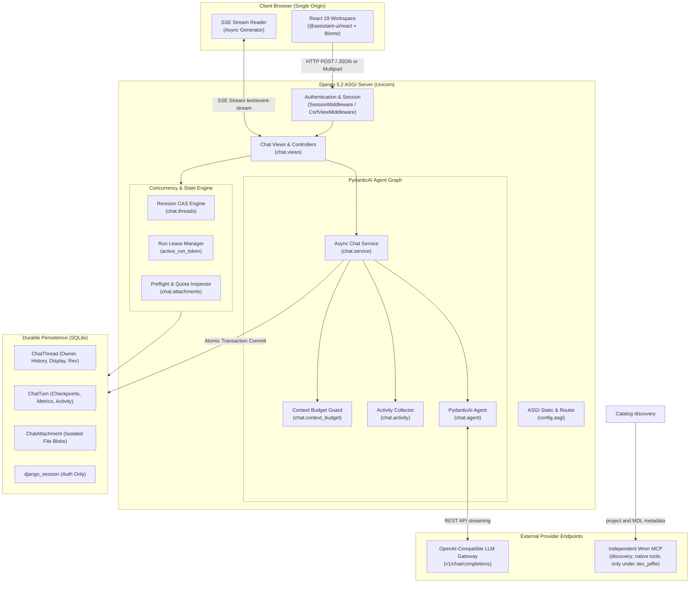

# System Architecture & Design Overview

This document provides a comprehensive technical overview of the **AYCE Analytics V2** system architecture, component topologies, and runtime execution boundaries.

---

## 1. High-Level System Architecture

AYCE Analytics V2 is a secure, single-origin, multi-user chat workspace engineered for enterprise data analytics. It bridges a modern **React 19** frontend with **Django 5.2 (ASGI)**, a **PydanticAI** agent orchestrator, an external **OpenAI-compatible LLM provider**, and an independent **Wren MCP** service. Catalog discovery always reads metadata. Reviewed native tools attach only when `AYCE_ANALYTICS_MODE=dev_jaffle` passes its gates and Django admits the full synthetic project. The shipped default is `off`. There is no Governed MCP Gateway. Production partial-dataset execution stays disabled.



---

## 2. Key Architecture Principles

1. **Owner-Scoped Data Boundary**:
   Every chat interaction requires an authenticated session (`@login_required`). Database queries strictly filter by `owner_id = request.user.pk`. Foreign thread IDs are returned as `404 thread_not_found`, completely isolating tenant data.

2. **Durable, Boundless Conversations with Atomic Checkpoints**:
   Instead of lossy conversational summaries or client-side context injection, canonical history is stored server-side as immutable JSON (`pydantic_ai.messages.ModelMessage` sequence). Before every turn, the conversation's exact canonical history is frozen into `ChatTurn.pre_history_json`. This enables exact, non-destructive regeneration and rollbacks.

3. **Optimistic Concurrency with Compare-and-Swap (CAS)**:
   Every thread carries a monotonically increasing integer `revision`. Any mutation (new turn, rename, delete, rollback) must provide the caller's expected revision. Stale client tabs fail with `409 thread_conflict` without corrupting state.

4. **Distributed Lease Locking**:
   In-flight generation is serialized per thread using a short database lease (`active_run_token` and `active_run_expires_at`). Two browser tabs or concurrent requests for the same thread cannot execute simultaneously, eliminating race conditions before calling the LLM or tool endpoints.

5. **Sanitized Failure & Public Error Envelope**:
   Exceptions, raw stack traces, SQL errors, or engine details are intercepted at the boundary and converted into fixed public error codes and localized user-friendly messages (e.g., `attachment_model_error`, `provider_timeout`, `warehouse_unavailable`).

6. **Conservative Budgeting & Early Preflight**:
   All operations undergo upfront quota and safety preflights (file counts, byte limits, XML decompression ratios, context token caps) before invoking background tasks, external APIs, or database updates.

---

## 3. End-to-End Turn Execution Lifecycle

The sequence diagram below illustrates the exact lifecycle of a chat message turn, from browser submission through streaming SSE responses to durable database commitment:

```mermaid
sequenceDiagram
    autonumber
    actor User as User Browser
    participant View as chat.views.thread_messages
    participant CAS as chat.threads (CAS & Lease)
    participant Svc as chat.service.stream_answer
    participant Agent as PydanticAI Agent Core
    participant LLM as OpenAI-Compatible Provider
    participant DB as SQLite Database

    User->>View: POST /api/threads/<id>/messages/ (CSRF, revision, message, files)
    Note over View: Run preflight in worker thread (auth, limits, validate settings)
    View->>CAS: acquire_run(owner_id, thread_id, revision)
    alt Thread busy or revision mismatch
        CAS-->>View: 409 thread_busy / thread_conflict
        View-->>User: JSON Error Envelope (Cache-Control: no-store)
    else Lease acquired
        CAS-->>View: run_token (UUID)
    end

    View-->>User: 200 OK (text/event-stream, : connected\n\n)

    par Lease Keep-Alive
        loop Every 60 seconds
            View->>CAS: renew_run(thread_id, run_token)
        end
    and Stream Consumption
        View->>Svc: load_grant_instructions(owner_id, department_id)
        View->>Svc: stream_answer(message, history, attachments, grant_instructions, check_authorization)
        Svc->>Agent: agent.iter(prompt, capabilities=[budget_hooks], instructions=grant_instructions)
        Note over Svc,Agent: check_authorization re-verifies owner, thread, department scope and the epoch before every model request; native tools attach only when the guarded toolset yields

        loop Agent Loop (Thinking & Tools)
            Agent->>LLM: Stream completion request
            LLM-->>Agent: Token chunk / tool call
            Agent-->>Svc: Model Request / Function Tool Call Event
            Svc-->>View: ActivityUpdate / TextDelta
            View-->>User: event: delta {"text": "..."}
            View-->>User: event: activity {"turn_id": "...", "step": {...}}
        end

        Svc-->>View: CompletedReply (reply text, history_json, metrics)
    end

    Note over View,DB: Commit Phase (Outside generation loop)
    View->>CAS: commit_turn(owner_id, snapshot, message, completed, run_token)
    DB->>DB: Atomic Update (increment revision, append display, save turn checkpoint, release lease)
    CAS-->>View: Committed ChatThread & ChatTurn
    View-->>User: event: done {"reply": "...", "thread": {...}, "turn": {...}}
    Note over View,User: Stream terminated cleanly
```

---

## 4. Subsystem Breakdown

### 4.1. Django ASGI & Web Layer (`chat/views.py`, `config/asgi.py`)
- Hosted via `uvicorn` using `scripts/serve.py`.
- In `DJANGO_DEBUG=true` mode, `ASGIStaticFilesHandler` wraps the Django ASGI application to serve static compiled assets (`chat/static/chat/dist/`) and Django admin assets from the same origin.
- All mutating endpoints enforce Django's CSRF token (`@csrf_protect`) sent via header `X-CSRFToken`.
- API endpoints return strict `application/json` responses with `Cache-Control: no-store`.
- Streaming endpoints serve `text/event-stream` with `X-Accel-Buffering: no` to prevent buffering by reverse proxies like Nginx.

### 4.2. Durable Concurrency & Persistence (`chat/threads.py`, `chat/models.py`)
- **ChatThread**:
  - `id`: Unique UUID identifier.
  - `owner`: Foreign key to `auth.User` (cascade delete).
  - `department`: Immutable nullable foreign key to the department context chosen at creation.
  - `quarantined`: Server-only lock. A locked history never reaches the model or the browser.
  - `title`: Dynamic or auto-derived title from first message (capped at 80 characters).
  - `history_json`: Canonical serialized `ModelMessage` array.
  - `display`: List of visible `{role, content}` message pairs.
  - `revision`: Monotonic integer CAS guard.
  - `active_run_token` & `active_run_expires_at`: Short 300-second lease to prevent parallel execution.
- **ChatTurn**:
  - Private per-turn audit and checkpoint record.
  - `pre_history_json`: History as it stood before the turn began.
  - `requested_model`, `resolved_model`, `completed_at`, `duration_ms`, `output_tokens`.
  - `activity`: Bounded execution timeline sidecar.
  - `output_limit_reached`: Boolean flag signaling token cutoff.
- **ChatTurnDataset**:
  - Private rows naming each dataset a turn exposed, with the definition and structure hashes seen at commit. Never returned by the public API.
- **ChatAttachment**:
  - Stores uploaded file blobs tied to the introducing turn.
  - Normalized payload representation (plain text for docx/xlsx, raw binary for images/pdf).

### 4.3. PydanticAI Agent Graph (`chat/service.py`, `chat/agent.py`)
- Built on top of `pydantic-ai-slim`.
- Configured with `OpenAIChatModel` pointing to `OpenAICompatibleProvider`.
- `build_agent(*, base_url, api_key, model_name, toolsets=())` attaches only server-created toolsets. An empty sequence stays tool-free. The browser never receives `WREN_MCP_URL` or a toolset.
- `stream_answer` accepts a keyword-only `check_authorization` callback and awaits it before every model request, including every subsequent model round. After any tool use it also rechecks the captured scope before protected text and completion.
- Every run receives `grant_instructions` from `chat.service.load_grant_instructions`. Only display name, code, and description are read. The unavailable sentence is omitted only after a guarded toolset is attached. Regeneration passes no analytics run and stays tool-free.
- Equipped with `make_budget_hooks` enforcing conservative preflight token estimations and strict post-completion provider usage boundaries.

### 4.4. Frontend Workspace (`frontend/src/`)
- Built with **React 19**, **TypeScript**, and **Vite 8**.
- Formatted and linted using **Biome**.
- Single-page application bootstrapped directly by server-rendered Django HTML (`chat/index.html`).
- Employs resilient optimistic UI updates, background SSE reading, per-thread in-memory drafts, and full keyboard navigation.

---

## Accounts and dataset governance

Two additional Django apps own the governance domain:

- `accounts` — `AuthorizationState` (singleton revision/epoch),
  `AuthorizationAudit` (append-only), `Department`, `DepartmentMembership`, plus
  `authorization.py` helpers and `services.py` audited mutations.
- `datasets` — `Dataset`, `DatasetCatalogState` (including retained
  `execution_metadata_json`), `DepartmentDataset`, `MembershipDataset`, metadata
  discovery and audited catalog/grant mutations.

`ChatThread` gained an immutable nullable `department` foreign key and a
server-only `quarantined` flag. Thread reads and runs resolve access from
current state (`available`, `quarantined`, `department_revoked`) after the usual
owner-scoped lookup, so a foreign thread id remains an identical
`thread_not_found`.

`stream_answer` attaches a reviewed native Wren toolset only when `dev_jaffle`
admission succeeds for that department. Otherwise the run stays tool-free.
AYCE owns identity, grants, orchestration and history. Wren remains an
independent service. `WREN_MCP_URL` is the discovery endpoint and, under
`dev_jaffle`, the approved loopback endpoint. It is not query authorization by
itself. The metadata catalog is not a production execution boundary.

Private catalog snapshots (`DatasetCatalogState.execution_metadata_json`) and
their snapshot, structure, and definition hashes identify the admitted
synthetic catalog and the provenance written with a used turn. Those hashes
are not physical isolation and not a gateway contract.

A used synthetic turn writes private `ChatTurnDataset` rows for every captured
dataset in the same transaction as the turn. A later read or run requires each
row to still match a currently eligible assignment with unchanged hashes;
otherwise the thread locks as `quarantined`. A provenance-bearing turn cannot
be regenerated. Ordinary provenance-free turns regenerate normally and receive
no native tools.
