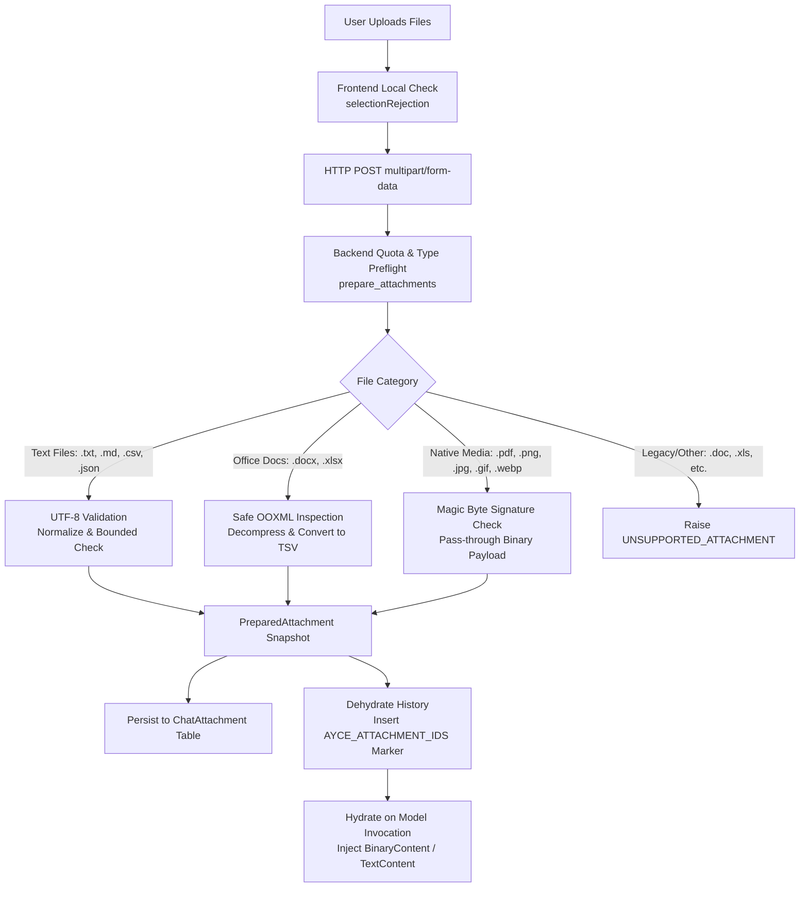

# Attachments Pipeline & Token Budgeting

This document outlines the multi-modal file attachment processing pipeline, OOXML/Office decompression safeguards, attachment hydration mechanics, and token context budgeting in **AYCE Analytics V2**.

---

## 1. Attachment Processing Architecture

AYCE Analytics V2 supports rich conversational attachments while enforcing defense-in-depth security against denial-of-service (DoS), zip bombs, XML external entity (XXE) attacks, and macro exploits.



---

## 2. Supported Formats & Media Types

Attachments are classified strictly by file extension and validated against magic byte signatures. The browser-reported `Content-Type` is never trusted.

| Extension | Detected Media Type | Processing Strategy | Target Representation |
| --- | --- | --- | --- |
| `.txt` | `text/plain` | UTF-8 decode & normalize | `TextContent` |
| `.md` | `text/markdown` | UTF-8 decode & normalize | `TextContent` |
| `.csv` | `text/csv` | UTF-8 decode & normalize | `TextContent` |
| `.json` | `application/json` | UTF-8 decode & validate | `TextContent` |
| `.docx` | `application/vnd.openxmlformats-officedocument...` | Safe OOXML extract | Tabular TSV plain text |
| `.xlsx` | `application/vnd.openxmlformats-officedocument...` | Safe OOXML extract | Tabular TSV plain text |
| `.pdf` | `application/pdf` | Magic byte `%PDF-` check | Native `BinaryContent` |
| `.png` | `image/png` | Magic byte `\x89PNG` check | Native `BinaryContent` |
| `.jpg`, `.jpeg` | `image/jpeg` | Magic byte `\xff\xd8\xff` check | Native `BinaryContent` |
| `.gif` | `image/gif` | Magic byte `GIF87a`/`GIF89a` check | Native `BinaryContent` |
| `.webp` | `image/webp` | Magic byte `RIFF...WEBP` check | Native `BinaryContent` |

Legacy binary formats (`.doc`, `.xls`, `.ppt`) and macro-enabled formats (`.docm`, `.xlsm`) are explicitly rejected with `400 unsupported_attachment`.

---

## 3. OOXML & Zip-Bomb Protection (`_inspect_ooxml`, `_scan_members`)

Word (`.docx`) and Excel (`.xlsx`) files are zip archives containing XML structures. To prevent malicious archives from exhausting server resources:

1. **Member Count Limit**: Maximum 1,000 entries (`MAX_OOXML_ENTRIES = 1_000`).
2. **Member Decompressed Size**: Maximum 5 MiB per file member (`MAX_OOXML_MEMBER_BYTES = 5 * 1024 * 1024`).
3. **Total Decompressed Size**: Maximum 20 MiB aggregate expansion (`MAX_OOXML_TOTAL_BYTES = 20 * 1024 * 1024`).
4. **Traversal & XML Block Limit**: Maximum 100,000 blocks visited (`MAX_OOXML_BLOCKS = 100_000`).
5. **XML Table Nesting Depth**: Maximum 20 levels (`MAX_OOXML_DEPTH = 20`).
6. **XXE & Entity Refusal**: Streams check for `<!doctype` and `<!entity` tokens and reject matching files with `400 invalid_attachment`.
7. **Macro Detection**: Inspects member names and `[Content_Types].xml` for `vbaproject` or `macroenabled` markers.

Office files are converted into plain-text tab-separated values (TSV) server-side, reducing prompt token size and eliminating formatting noise.

---

## 4. Dehydration & Hydration Pattern

To keep canonical JSON history lightweight, fast to serialize, and under the 128 KiB history limit, large file payloads are never embedded into stored conversation JSON.

### 4.1. Dehydrated Representation (`dehydrate_messages`)
Stored in `ChatThread.history_json`:
```json
{
  "kind": "request",
  "parts": [
    {
      "part_kind": "user-prompt",
      "content": [
        {
          "type": "text",
          "content": "Analyze the financial summary attached.",
          "metadata": {
            "ayce_attachment_ids": ["8f7d9210-234b-48ae-94a2-e64e10c7104b"]
          }
        }
      ]
    }
  ]
}
```

### 4.2. Model Hydration (`hydrate_history`, `hydrate_user_content`)
When preparing the prompt for PydanticAI execution:
- Attachment IDs are looked up in the `ChatAttachment` table.
- Plain text / TSV files are hydrated into `BinaryContent` with UTF-8 text media types.
- Native images and PDFs are hydrated as `BinaryContent` with their raw bytes and MIME types.
- File names are prefixed: `"Attached file: filename.csv"`.
- If a model does not support native multimodal inputs (e.g., standard text models receiving PDFs), PydanticAI's adapter raises an error mapped to `502 attachment_model_error`.

---

## 5. Token & Context Budgeting (`chat/context_budget.py`)

AYCE Analytics V2 implements strict, application-owned token budgeting before and during generation.

### 5.1. Configuration Keys
- `LLM_CONTEXT_WINDOW`: Total input token budget + reserved output tokens (default: `32768`).
- `LLM_MAX_OUTPUT_TOKENS`: Maximum output tokens requested per completion (default: `4096`).
- Rule enforced at startup: `LLM_MAX_OUTPUT_TOKENS < LLM_CONTEXT_WINDOW`.

### 5.2. Preflight Token Estimation (`estimate_text_input_tokens`)
Because `OpenAIChatModel` cannot invoke local tokenizers offline, the system calculates a conservative token estimate:
$$\text{Estimated Tokens} = \text{UTF-8 Byte Count of Serialized Messages} + \text{Instruction Bytes} + \text{Tool Definition Bytes} + 1024 \text{ (Framing Tokens)}$$
- Assuming 1 token per UTF-8 byte intentionally overestimates text tokens, ensuring requests will never exceed provider capacities unexpectedly.
- Native images and PDFs are left provider-authoritative and not guessed.

### 5.3. PydanticAI Budget Hooks (`make_budget_hooks`)
Two hooks run on every model round:
1. `before_model_request`:
   - Checks if $\text{Estimated Input Tokens} > \text{Effective Window} - \text{Max Output Tokens}$.
   - Raises `ContextBudgetExceeded` (surfaced as `400 context_limit`).
2. `after_model_request`:
   - Inspects provider-reported usage (`usage.input_tokens`).
   - If provider reports an overrun, raises `ContextBudgetExceeded`.
