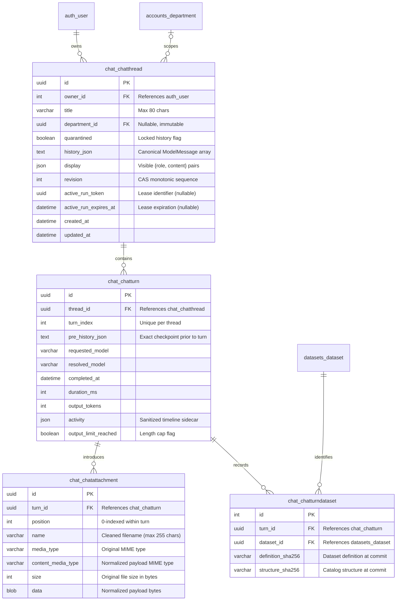

# Concurrency, Storage & Checkpoints

This document describes the durable data storage model, multi-user concurrency control, run lease management, and checkpoint-based turn manipulation in **AYCE Analytics V2**.

---

## 1. Storage Architecture & ER Model

Conversations belong exclusively to authenticated Django user accounts (`auth.User`). Anonymous sessions are rejected, and foreign conversations cannot be read, updated, or deleted.



---

## 2. Compare-and-Swap (CAS) Concurrency

To prevent multi-tab conflicts and lost updates without relying on heavyweight database table locking, every mutating operation on `ChatThread` uses **Compare-and-Swap (CAS)** on the `revision` column.

### 2.1. Mechanism
1. When a client tab reads or loads a thread, it receives the current integer `revision`.
2. When submitting a message, renaming, or deleting an exchange/thread, the client passes `{ "revision": N }`.
3. The server executes an atomic conditional update:
   ```python
   updated = ChatThread.objects.filter(
       owner_id=owner_id,
       pk=thread_id,
       revision=revision,
   ).update(
       revision=revision + 1,
       ...
   )
   ```
4. If `updated == 0`:
   - If the thread still exists, a conflicting write occurred: raises `ChatError("thread_conflict")` (HTTP 409: *"This chat changed in another tab. Reload it before trying again."*).
   - If the thread is missing: raises `ChatError("thread_not_found")` (HTTP 404).

---

## 3. Run Lease Locking (`active_run_token`)

Generating assistant responses involves external network latency (streaming LLMs and MCP tool executions) that should not be wrapped inside long-lived database transactions. To prevent concurrent runs on the same thread, a lightweight database lease pattern is employed.

### 3.1. Lease Parameters
- **Duration**: 300 seconds (`RUN_LEASE_SECONDS = 300`).
- **Heartbeat Interval**: 60 seconds (`RUN_RENEW_INTERVAL_SECONDS = 60`).

### 3.2. Lifecycle
1. **Acquire (`acquire_run`)**:
   Before establishing the SSE stream, the server attempts to acquire the lease:
   ```python
   updated = (
       ChatThread.objects.filter(
           owner_id=owner_id,
           pk=thread_id,
           revision=revision,
       )
       .filter(
           Q(active_run_token__isnull=True)
           | Q(active_run_expires_at__isnull=True)
           | Q(active_run_expires_at__lte=now)
       )
       .update(active_run_token=token, active_run_expires_at=expires)
   )
   ```
   If this update fails, another run is in progress: raises `ChatError("thread_busy")` (HTTP 409: *"This chat is already working on a reply. Wait for it to finish."*).

2. **Renew (`renew_run`)**:
   A background task runs alongside the stream. Every 60 seconds, it extends `active_run_expires_at` by 300 seconds, provided `active_run_token` matches.

3. **Release (`release_run`)**:
   When the turn completes, encounters an error, or the client disconnects (`ASGI http.disconnect`), the lease is cleared in a shielded `finally` block:
   ```python
   ChatThread.objects.filter(
       owner_id=owner_id,
       pk=thread_id,
       active_run_token=run_token,
   ).update(active_run_token=None, active_run_expires_at=None)
   ```

---

## 4. Checkpoints, Regeneration & Exchange Removal

A key architectural advantage of AYCE Analytics V2 is non-destructive turn management.

### 4.1. Checkpoint Storage
When turn $K$ completes, the thread's canonical history *before* turn $K$ was applied is recorded verbatim in `ChatTurn.pre_history_json`.
- The checkpoint is private metadata: it is never serialized to the client browser.
- Checkpoints are validated using `service.load_history(...)` before being accepted.

### 4.2. Regenerating the Latest Answer (`commit_regeneration`)
- **Endpoint**: `POST /api/threads/<thread_id>/turns/<turn_id>/regenerate/`
- **Validation**:
  - The requested turn must be the latest completed turn (`turn_index == len(display) // 2 - 1`).
  - Must have a valid `pre_history_json` checkpoint.
  - Must not carry dataset provenance: `require_turn_regenerable` refuses any turn with a `ChatTurnDataset` row, returning `503 warehouse_unavailable`. `commit_regeneration` also refuses a completion that carries `analytics_scope`. The check runs before checkpoint hydration or lease acquisition and again inside the commit transaction. Regeneration never receives native Wren tools.
  - Caller must supply the current thread `revision`.
  - Acquisition of `active_run_token` is required.
- **Execution**:
  - Re-executes the exact original prompt using `turn.pre_history_json` as the starting history.
  - No text or history is ever accepted from the browser, preventing prompt tampering.
  - Replaces only the final assistant text in `display`.
  - Replaces turn metrics (`duration_ms`, `output_tokens`, `activity`).
  - Writes no dataset provenance. A caller cannot attach an analytics scope to a regenerated result. Ordinary provenance-free turns remain regenerable and tool-free.
  - Keeps the same `turn_id` and increments thread `revision` by 1.

### 4.3. Deleting the Latest Exchange (`delete_latest_turn`)
- **Endpoint**: `DELETE /api/threads/<thread_id>/turns/<turn_id>/`
- **Validation**:
  - Must be the latest completed exchange.
  - Lease must be idle (`_idle_lease_filter`).
- **Execution**:
  - Restores `ChatThread.history_json` directly from `turn.pre_history_json`.
  - Slices the last two entries (`user` and `assistant`) off `ChatThread.display`.
  - Cascades delete to `ChatTurn`, its `ChatAttachment` rows, and its `ChatTurnDataset` rows.
  - Increments thread `revision` by 1.
  - The previous turn now becomes the latest turn and is eligible for subsequent regeneration or deletion!


### 4.4. Saved query provenance (`ChatTurnDataset`)
A used synthetic DEV turn writes private per-turn dataset provenance for every captured dataset in the same transaction as the turn. Older saved query results use the same rows. The rows are private: reads, runs, regenerations and rollbacks may use them, and no public response includes them. A later read or run requires each row to still match a currently eligible assignment with the same definition and structure hashes. A mismatch locks the thread as `quarantined`, redacts its title, and keeps saved rows away from the browser and the model. Those hashes identify catalog identity. They are not physical isolation. Deleting the latest turn deletes those rows with the turn. A turn that still carries provenance cannot be regenerated. Ordinary provenance-free turns write no provenance, regenerate normally, and receive no native tools.

---

## 5. Capacity & Quota Invariants

| Guard | Limit | Purpose |
| --- | --- | --- |
| Max Message Length | 2,000 characters | Prevents oversized user inputs |
| Max Turns Per Thread | 20 completed turns | Bounds conversational drift and context degradation |
| Max Serialized History | 128 KiB | Bounds thread memory footprint |
| Max Checkpoint Budget | 2.5 MiB (20 × 128 KiB) | Bounds total checkpoint storage per thread |
| Max Stored Attachments | 5 files per thread (default) | Configurable file quota |
| Title Length | 80 characters | Thread naming convention |

---

## Administration concurrency and the authorization epoch

Administration writes use one more serialization point: the singleton
`accounts.AuthorizationState` row (`id=1`). Every mutation's first database
write is a conditional update of that row at the caller's `revision`; zero rows
means `409 administration_conflict`. Because SQLite has no row-level
`select_for_update`, this single write is what serializes management writes,
including the last-administrator check. Reported SQLite lock/busy errors map to
the same safe conflict, without retries or raw database messages.

The same row carries `epoch`, incremented for role, status, membership,
entitlement, grant, department-activation and dataset-binding/activation
changes. A department-bound chat run records the epoch it started under and:

1. re-checks owner, thread, department scope and epoch before every model round
   through the `check_authorization` callback `chat.service.stream_answer`
   awaits,
2. re-reads active user, thread access and epoch at most once per second while
   streaming (before each outgoing delta),
3. renews the 300-second lease on its own 60-second timer,
4. takes the authorization write lock and re-checks the epoch inside the commit
   transaction, before the existing thread revision/token/expiry update.

An epoch change therefore cannot slip between a check and a commit: the commit
returns `409 authorization_changed` and nothing is written. General chats only
require an active owner, so unrelated department policy changes never
invalidate them. Access loss cancels the pump, discards pending work and still
releases the lease.

The legacy classification migration (`chat.0006_legacy_classification`) only
sets `ChatThread.quarantined`; conversation and checkpoint bytes, attachment
payloads, ids, owners, revisions and leases are preserved exactly.
